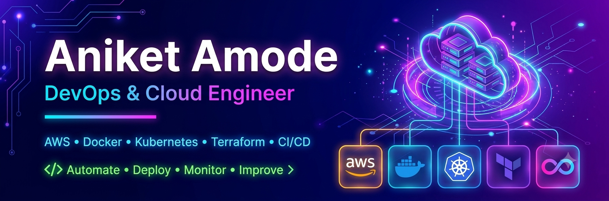

<!--
PROFILE README SETUP
1. Keep this README.md in the root of the public repository:
   https://github.com/Aniket7293a/Aniket7293a
2. Upload your own banner to assets/github-banner.png
3. Add .github/workflows/snake.yml to enable the contribution snake.
4. Run the workflow once from the Actions tab.
-->

  

  <h1>Hi 👋, I'm Aniket</h1>
  <h3>Aspiring DevOps &amp; Cloud Engineer | AWS • Docker • Kubernetes • CI/CD</h3>

  

  

    
    
    
  

  

    
    
    
  

---

## 👨‍💻 About Me

- 🎓 I'm an **IMCA student** building my career in **DevOps and Cloud Engineering**.
- ☁️ I have hands-on practice with **AWS services** including EC2, S3, IAM, and CloudFormation.
- 🐳 I work with **Docker, Kubernetes, Linux, Git, GitHub, and GitHub CLI** through practical exercises.
- ⚙️ I practise automation and scripting with **Jenkins, GitHub Actions, Bash, and Python**.
- 🗄️ I also work with **MySQL** and am developing my understanding of infrastructure automation.
- 📚 I'm documenting my learning through the **90DaysOfDevOps** journey.
- 🌱 Currently deepening my knowledge of **Terraform, GitHub Actions, ArgoCD, Helm, Prometheus, and Grafana**.
- 💼 Open to **DevOps / Cloud Engineering internships and entry-level opportunities**.

 

---

## 🧰 Tech Stack

### ☁️ Cloud & Infrastructure

  

  

### 🐳 Containers & Orchestration

  

### ⚙️ CI/CD & Version Control

  
  

### 💻 Programming & Scripting

  

### 🐧 Operating Systems & Databases

  

---

## 🌱 Currently Learning & Exploring

  
  
  
  
  
  

---

## 🚀 Featured Projects

<table>
  <tr>
    <td width="50%" valign="top">
      <h3>🚗 Car-Sathi</h3>
      
A carpooling website designed to connect drivers and passengers travelling along similar routes, making ride sharing more convenient and affordable.

      
<b>Built with:</b> HTML • CSS • JavaScript

      
<a href="https://github.com/Aniket7293a/Car-Sathi">View Repository →</a>

    </td>
    <td width="50%" valign="top">
      <h3>📚 90DaysOfDevOps</h3>
      
My public learning track for building DevOps foundations through daily tasks, practical exercises, and technical notes. The repository includes year-wise learning material, including 2026.

      
<b>Focus areas:</b> Linux • Git • Shell • AWS • Docker • CI/CD • Kubernetes • Terraform

      
<a href="https://github.com/Aniket7293a/90DaysOfDevOps">View Repository →</a>

    </td>
  </tr>
</table>

<!-- Add the Jenkins Shared Libraries project here after confirming its exact public repository URL and the work it contains. -->

---

## 📈 GitHub Activity

  
  
   
  

---

## 🐍 Contribution Snake

  <picture>
    <source media="(prefers-color-scheme: dark)" srcset="https://raw.githubusercontent.com/Aniket7293a/Aniket7293a/output/github-contribution-grid-snake-dark.svg" />
    <source media="(prefers-color-scheme: light)" srcset="https://raw.githubusercontent.com/Aniket7293a/Aniket7293a/output/github-contribution-grid-snake.svg" />
    
  </picture>

---

## 🤝 Let's Connect

  
  
  

---

  <b>Learn → Build → Practise → Automate → Improve</b>
   
  <i>Learning in public, one practical step at a time.</i>

